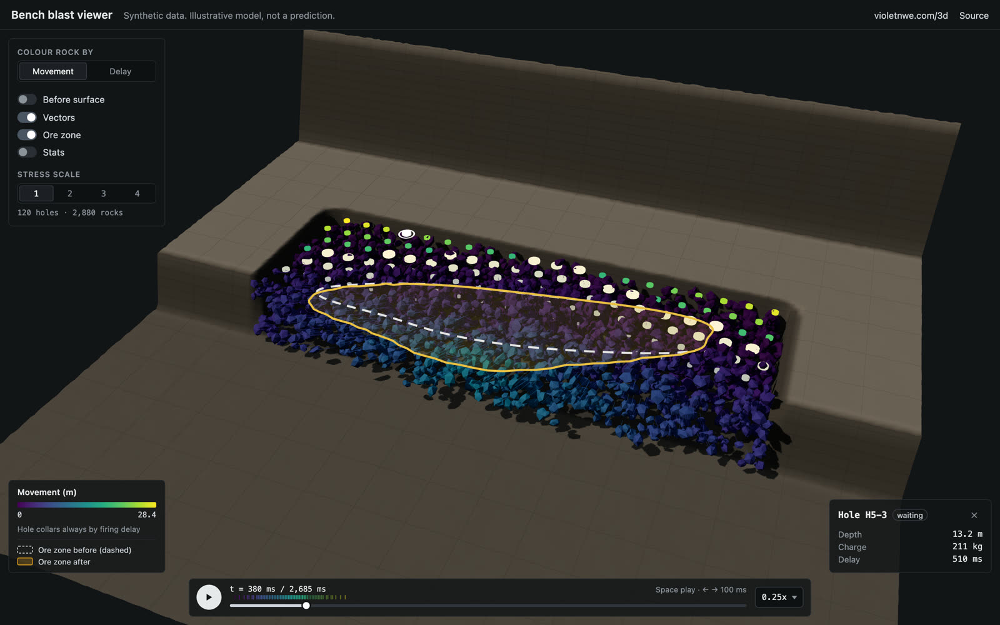
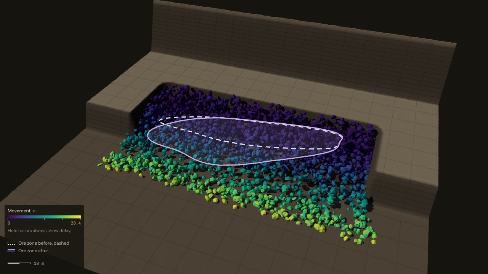
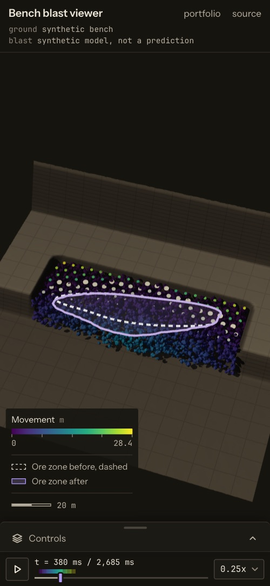
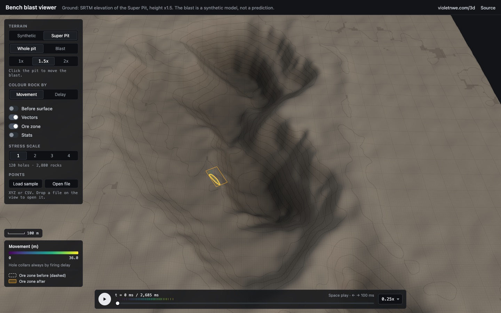
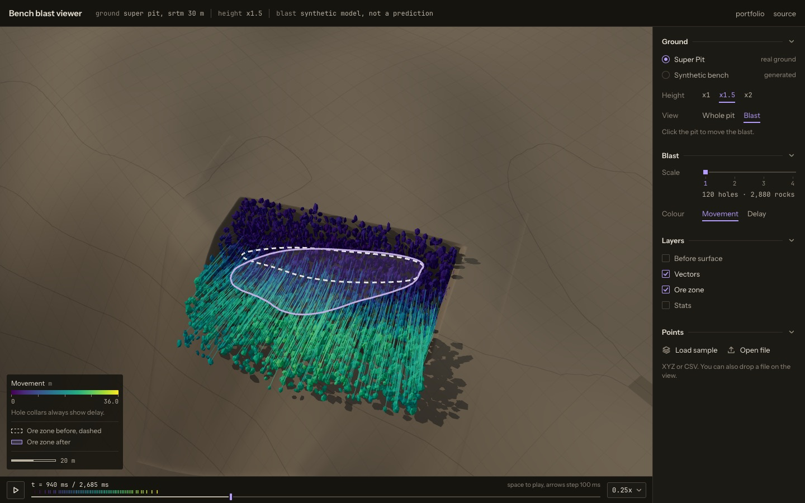

# Bench blast viewer

An interactive 3D viewer for blast movement on an open-pit bench: drill holes fire on their delays, the rock mass moves into a muck pile, and the ore zone is shown before and after. It is a portfolio demo of interactive 3D blast-movement visualisation. The ground is the real Super Pit at Kalgoorlie, from public elevation data, or a synthetic bench. The blast is synthetic on both.

**Live:** https://violetn22.github.io/blast-viewer/

> The blast is synthetic. Illustrative model, not a prediction. Nothing here is calibrated to a real site, rock mass or explosive, and it should not be used to plan or assess a blast. The Super Pit ground is real elevation data, but the blast laid on it is not.



| End of the blast, ore zone before (dashed) and after | Phone, portrait |
| --- | --- |
|  |  |

## What it shows

- **The ground.** The Super Pit from real elevation data (the default), or the synthetic bench. The Terrain picker switches between them. See [Real terrain](#real-terrain).
- **The firing sequence.** Each hole collar is coloured by its firing delay. Press play, or scrub the timeline, which has one tick per delay. Holes fire in order and the rock around them moves.
- **Rock movement.** About 2,900 rock fragments at the default scale are coloured by how far they moved (a viridis-like ramp with a legend in metres) or by delay. Optional vectors draw the displacement for a sample of fragments.
- **The ore zone.** A dig line at mid-bench: dashed white for the outline before the blast, solid violet for the outline after. The violet outline moves with the rock while the blast plays.
- **The pre-blast surface**, as an optional ghost over the muck pile.
- **Hole details.** Click a collar, or pick a hole from the keyboard Holes list, to see its depth, charge, delay, and whether it has fired.
- **A stress scale.** The Scale slider, 1 to 4, rebuilds the scenario with more holes and up to ten times the fragments, so you can watch the cost in the stats overlay. A drag builds only the value it is let go on.
- **Phones.** A phone is a window under 768 px wide or 500 px tall or less (the same rule as the phone CSS), so a phone held in landscape counts too. On a phone the viewer starts light, at scale 1 with vectors off, and the controls sit in a bottom sheet. A tap on its handle opens it half way or closes it, a drag snaps it to closed, half or full, and Up and Down on the handle do the same. The legend and the scale bar stay above the sheet. In portrait the camera looks down more steeply, so the block fills about 75% of the width.
- **No WebGL.** If the browser cannot start WebGL, the page plays a recording of the live viewer instead (`public/fallback/blast.mp4`) and never builds the scenario. If the WebGL context is lost, the viewer waits about 3 s for the browser to restore it (a phone tab coming back from the background) and carries on if it does. If it does not, or the renderer fails, the recording plays with a note that the 3D view stopped, and moving the scale tries the live view again.

Keys: Space plays and pauses. Left and Right step 100 ms, and so do Up and Down on the scrubber. PageUp and PageDown step 500 ms on the scrubber, and Home and End jump to the start and the end. Escape closes the topmost panel (the controls sheet on a phone, then the hole card). A `?t=<ms>` or `?t=end` link opens the viewer at a given time, and a linked time does not autoplay. With reduced motion turned on, the viewer does not autoplay.

### Keyboard access

What works from the keyboard:

- Every DOM control: the header links, the group titles, the terrain, height, view and colour radios, the scale slider, the layer checkboxes, the points buttons, the sheet's handle (phones), play and pause, the time scrubber, the speed menu, and the hole card's close button. All have visible focus rings and labels.
- Holes, through the **Holes** list in the view options. It is visually hidden and shows a hint line while it has focus; it comes after the colour choice in the tab order (on a phone, inside the controls sheet). Up and Down (or Home and End) move through the holes, and Enter or Space opens the hole's card and moves focus to it. Escape or the close button closes the card and returns focus to the list (on a phone, to the sheet's handle).
- The hole card is a live region, so screen readers announce it when it opens.

What does not: the 3D camera. Orbit, zoom and pan are pointer and touch only, and clicking a collar in the 3D view needs a pointer (the Holes list is the keyboard route to the same card). Moving the blast on the pit is a click on the ground, so it needs a pointer too.

## Real terrain





The viewer opens on the Super Pit (Fimiston Open Pit) at Kalgoorlie, Western Australia. The ground is a real elevation model of the pit and the land around it. Heights are metres above sea level. By default they are drawn 1.5 times taller than they are, so the benches and the bowl read from above. The **x1 / x1.5 / x2** Height control under the Terrain picker changes this, and the status line in the header says which is on. The light is a low sun from the north-west with a soft sky fill. The shading uses normals from the grid at its real spacing, lightly smoothed so the 30 m source does not shade as streaks. Contours every 20 m and the 100 m grid are drawn in true metres, whatever the exaggeration. The whole-pit view looks south from the north rim, about 35 degrees down. The scale bar under the legend gives the length of a round distance at the centre of the view.

The grid comes from AWS Terrain Tiles. Over Kalgoorlie the tiles are built from SRTM, which was flown in February 2000, so the pit is shown as it was then and is smaller than it is today. SRTM has a sample about every 30 m. That is enough for the pit, the ramps and the waste dumps, but not for single benches, so a wall reads as one slope.

`scripts/fetch-terrain.mjs` fetched the tiles once at about 8 m per pixel, stitched them, filled SRTM voids (single samples far from their neighbours) with the local median, and cropped the grid to the pit. It wrote a 16-bit greyscale PNG and a JSON file with the bounds, the cell size and the date fetched to `public/terrain/`. The app reads those two files and never fetches tiles. The centre, size and zoom are at the top of the script, and `node scripts/fetch-terrain.mjs` fetches them again.

The blast model is the one the synthetic bench uses. It works in its own frame, with the crest along one axis and the free face toward the other, so on the pit it needs only a crest point, a face direction and a floor plane. On load the viewer picks a bench inside the pit. It tries points across the pit, takes the steepest way down from each, walks to where the ground turns into a face, and scores the ground behind that crest with a plane fit over the pattern's footprint. The flattest, smoothest one wins. A click on the pit runs the same search from the point clicked and moves the blast there. If there is no face at that point, it looks further out, in rings up to 400 m, and puts the blast on the nearest face it finds. When that is more than 40 m from the click, the note under the picker says how far it moved. The face direction is downhill, so rock is thrown down the slope. The bench height is the drop from crest to toe, capped at 18 m, and the face angle is the mean slope of that drop. Everything else in the model is unchanged and still synthetic. The model needed no new parameter for the face direction, since the frame is turned instead. The bench floor is not level: it is a plane parallel to the fitted bench top, one bench height below it, so the blasted block sits on the wall with the slope rather than as a flat cut into it.

**Whole pit** and **Blast** under the Terrain picker frame the camera. The blast block has a violet outline in the whole-pit view so it can be found.

### Data and attribution

Terrain Tiles was accessed on 3 November 2026 from https://registry.opendata.aws/terrain-tiles.

The tile headers over this area name SRTM and GMTED2010 as the sources: SRTM and GMTED2010 data courtesy of the U.S. Geological Survey. The baked grid is a modified copy of the tiles: voids filled with the local median, cropped to the pit, and stored in 5 cm steps.

The data is from the providers listed in the [Terrain Tiles attribution](https://github.com/tilezen/joerd/blob/master/docs/attribution.md), which asks for this attribution:

```
* ArcticDEM terrain data DEM(s) were created from DigitalGlobe, Inc., imagery and
  funded under National Science Foundation awards 1043681, 1559691, and 1542736;
* Australia terrain data © Commonwealth of Australia (Geoscience Australia) 2017;
* Austria terrain data © offene Daten Österreichs – Digitales Geländemodell (DGM)
  Österreich;
* Canada terrain data contains information licensed under the Open Government
  Licence – Canada;
* Europe terrain data produced using Copernicus data and information funded by the
  European Union - EU-DEM layers;
* Global ETOPO1 terrain data U.S. National Oceanic and Atmospheric Administration
* Mexico terrain data source: INEGI, Continental relief, 2016;
* New Zealand terrain data Copyright 2011 Crown copyright (c) Land Information New
  Zealand and the New Zealand Government (All rights reserved);
* Norway terrain data © Kartverket;
* United Kingdom terrain data © Environment Agency copyright and/or database right
  2015. All rights reserved;
* United States 3DEP (formerly NED) and global GMTED2010 and SRTM terrain data
  courtesy of the U.S. Geological Survey.
```

## Your own points

**Load sample** or **Open file** in the Points panel, or drop a file on the view. A file holds one point per line: x, y and z, or easting, northing and RL, split by commas, spaces or tabs. A header line is optional and can name the columns in any order. Lines that are not three numbers are skipped, and the panel says how many. A file over 100 MB is refused with a message, and so is a file with no points in it.

The file is parsed in a web worker and never leaves the browser. The points show on their own, with the terrain and the blast put away, centred on their own centroid and coloured by height. Easting is drawn east and northing north. **Back to the blast** returns to the terrain.

The sample, `public/samples/super-pit-points.csv`, is a few thousand points taken from the baked Super Pit grid, in MGA zone 51 coordinates. It is there so the feature can be tried without a file.

## Stack

React 19, TypeScript, Vite, three.js through React Three Fiber and drei, zustand for state, Vitest, Playwright (Chromium) and GitHub Actions. The site is deployed to GitHub Pages.

The type is Instrument Sans for labels and JetBrains Mono for numbers, units and time. Both are self-hosted in `public/fonts/` as variable woff2 files cut down to Latin, about 34 kB together, and preloaded.

## How the data is synthesised

On the synthetic bench, everything comes from a single seed (`public/scenarios/default.json`) through a seeded PRNG, so a given seed always builds the same scenario. A bench profile is generated first: a bench top, a sloped free face, a pit floor and a back wall, with seeded noise. A staggered burden-by-spacing drill pattern is laid on the bench top. Delays fan out from an initiation column, with a hole-to-hole delay along each row and a row-to-row delay behind it. Rock fragments are sampled through the blasted block and the face wedge. Each fragment gets its end point from a displacement field. The field throws rock forward through the free face, with the throw decaying with distance behind the crest, scales it with the local charge, and drops the result onto a muck-pile surface that heaves at the back and slumps across the floor. Fragments start moving when their nearest hole fires and follow an eased arc, over a flight time that grows with distance. The ore zone is a closed outline that is pushed through the same field. None of this is a physical blast model. It is a plausible shape for exercising a visualisation.

## Architecture

```
src/sim/     pure, seeded model: rng, terrain, pattern, fire, field, blast, scenario, params
             validation, easing; the DEM grid, terrarium decoding, bench fitting and the site
             frame (no three.js, unit-tested)
src/lib/     small helpers: phone detection and defaults, timeline and perf formatting,
             hasWebGL() feature probe, 16-bit PNG decoding and the DEM loader, the points
             parser and its worker, the scale bar
src/state/   zustand store: scenario, ground, time, playback, view toggles, stress scale, loaded
             points; perf stats and scale stores
src/scene/   React Three Fiber: Stage (canvas, framing, camera clamp, player, context loss),
             terrain mesh, DEM mesh, instanced holes and fragments, vectors, ore-zone dig line,
             site marker, point cloud stage, perf and scale probes, error boundary
src/ui/      DOM overlays: header, view controls, keyboard hole list, legend, scale bar, hole
             card, timeline, perf overlay, WebGL fallback
```

Imports point one way: `ui` and `scene` use `state`, `lib` and `sim` (and `ui` shares `scene`'s colour ramps); `state` uses `lib` and `sim`; `lib` uses only `sim` types; `sim` imports nothing from the app.

- **Sim layer.** `buildScenario(params, dem)` returns the terrain, holes, the resolved pattern options, fragments (typed arrays of the from and to positions and the fire and flight times) and the duration. On the pit it also returns the site, the frame the model runs in. It is deterministic, and the whole layer is covered by Vitest.
- **Store.** The UI and the scene read one store. `setScale` rebuilds the scenario and keeps the playhead at the same fraction of the duration. Components subscribe to narrow selectors: only the scrubber and the readout re-render on each playing frame.
- **Scene.** On the pit the DEM is one mesh with the blast patch cut out of it. The patch is the DEM resampled into the model frame at 1 m, and a group turns and lifts the blast onto the site. Fragments and holes are instanced meshes whose matrices and colours are written in place in `useFrame`, with no per-frame allocations. Outside playback the canvas renders on demand. The camera frames the block once per scenario and is clamped above the terrain. A renderer error, or a WebGL context that is not restored within about 3 s, is caught by an error boundary, which swaps the canvas, the stats and the timeline dock for the recording in one render and resets when the scenario changes.
- **UI.** Plain React and CSS over the canvas. Every DOM control has a label and keyboard access; the 3D camera does not (see Keyboard access).

## Tests and CI

| Gate | Count |
| --- | --- |
| `npx tsc --noEmit` | strict, 0 errors |
| `npx vitest run` | 110 tests in 23 files (sim, DEM and PNG decoding, bench fitting, points parser, scene maths, store, formatting, phone rules, WebGL probe) |
| `npm run build` | type check, then the production build |
| `npx playwright test` | 35 end-to-end tests in Chromium: smoke (3), UI (10), robustness (15), terrain (7) |

The UI specs cover scrubbing, the play and step keys, clicking a hole, the keyboard Holes list (focus to the card and back), the 375 px phone layout, `?t=` links, a closed panel group that stays closed after a reload, the scale slider on the keyboard, and the phone sheet's two heights. The robustness specs cover the fallback without WebGL (and that it never fetches the scenario), that the WebGL path never fetches the recording, a lost context that is restored and one that is not, a renderer error that a new scenario retries, the phone layout and portrait framing, the stress scale raising the instance count, no console errors on load, Escape order, the scrubber keys, the landscape controls sheet scrolling, an 844x390 landscape phone, and turning reduced motion on mid-load. The terrain specs cover the picker, a click on the pit that moves the pattern onto a bench there and plays the blast, the sample points, a file with bad lines, a wrong file and a file over the limit, and the pit on a 375 px phone. The UI and robustness specs open the synthetic bench (`?terrain=bench`), since they measure its framing. The smoke specs check the page renders with no console errors that the static HTML carries the loading line and share metadata, and that both fonts are preloaded and used.

CI (`.github/workflows/ci.yml`) runs every gate on pushes to `main` and on pull requests. Playwright runs against an e2e build (`VITE_E2E=1`), which exposes the store and test hooks on `window`; on CI it retries once and uploads the HTML report and traces when it fails. The deployed build strips the hooks. The `deploy` job in the same workflow needs the test job, so only a tested commit on `main` reaches GitHub Pages.

## Performance

Measured with `scripts/measure-perf.mjs`: frames counted over 10 s of a blast playing at 0.25x, at 1440x900 and device pixel ratio 2, with the stats overlay read at the end. The min is the slowest 1 s window. The setup was **headless Chromium on an Apple-silicon MacBook with dev load present** (load average about 8). Treat the fps as a floor, not a benchmark.

| Ground | Stress scale | Rocks | fps (mean) | fps (min) | Draw calls | Triangles | Instances |
| --- | --- | --- | --- | --- | --- | --- | --- |
| Super Pit, whole-pit view (default) | 1 | 2,880 | 59.4 | 54 | 10 | 508k | 3,000 |
| Super Pit, blast view | 1 | 2,880 | 59.5 | 55 | 9 | 508k | 3,000 |
| Synthetic bench | 1 | 2,880 | 59.8 | 58 | 8 | 110k | 3,000 |
| Synthetic bench | 4 | 28,800 | 59.4 | 54 | 8 | 678k | 29,100 |

Every row holds the display's 60 fps cap, so the numbers show headroom rather than a limit. Draw calls are the overlay's count with the default layers on (vectors and the ore zone). The rock and the collars are instanced, so the count does not grow with scale. The DEM adds about 400k triangles and one draw call.

Everything in `dist` except the media and the terrain is about 340 kB gzipped, as Vite reports it (HTML, CSS and JS; three.js alone is 184.30 kB), plus the 63-byte scenario file. The points worker is a separate 2.35 kB file, loaded when points are opened. The budget for the initial JS is 1.2 MB. On the pit the viewer also fetches the terrain grid (156 kB) and its metadata. The sample points (140 kB) load only on **Load sample**, and the fallback recording (6.8 MB) and its poster (0.26 MB) only when the fallback is shown.

## Run it

```
npm ci
npm run dev            # http://localhost:5173/blast-viewer/ (?terrain=bench for the synthetic bench)
node scripts/screenshot.mjs --size 1440x900,844x390   # screenshots of the dev server into artifacts/
npm test               # Vitest
npm run build          # type check and production build into dist/
npx playwright install chromium
npx playwright test    # builds the e2e bundle and serves it on :4173
node scripts/fetch-terrain.mjs   # fetch the Super Pit tiles again and rebake public/terrain/ and the sample
```

The fallback recording is frame-stepped and repeatable: the store is paused and stepped one frame at a time, and each frame is screenshotted at 1920x1080 and 30 fps, then encoded with ffmpeg (H.264). It is not byte-for-byte identical across machines, since the output depends on the GPU and the ffmpeg build. The script uses `ffmpeg` on PATH, or the binary named in `FFMPEG`, and replaces the committed files only when the whole run succeeds.

```
VITE_E2E=1 npm run build && npm run preview -- --port 4173
node scripts/capture-fallback.mjs
```

## Licence

MIT, see [LICENSE](LICENSE). The two fonts are under the SIL Open Font License 1.1; the licence texts are next to them in `public/fonts/`.

## Author

Built by [VioletN22](https://github.com/VioletN22). The blast data is synthetic and generated from a seed, and the Super Pit ground is SRTM elevation data (see [Data and attribution](#data-and-attribution)). It is an illustrative model, not a prediction.
